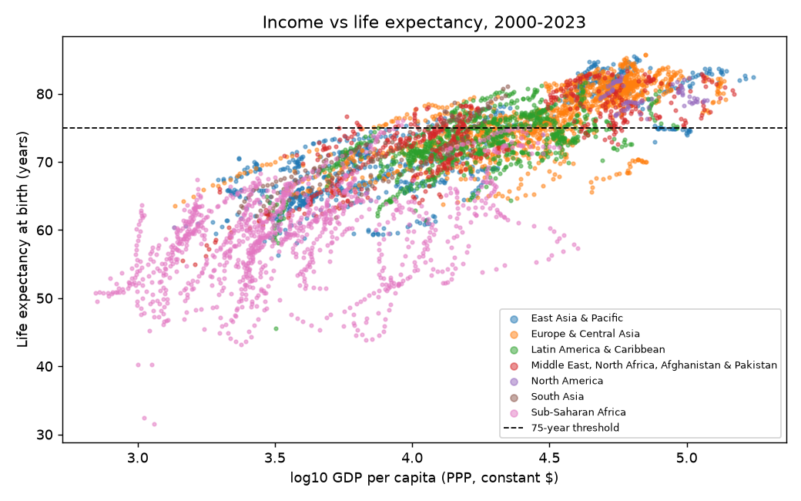
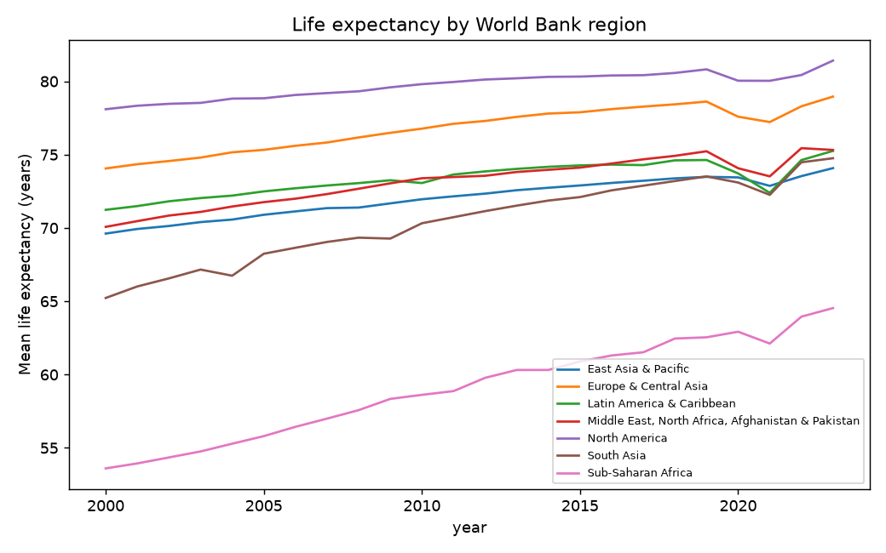
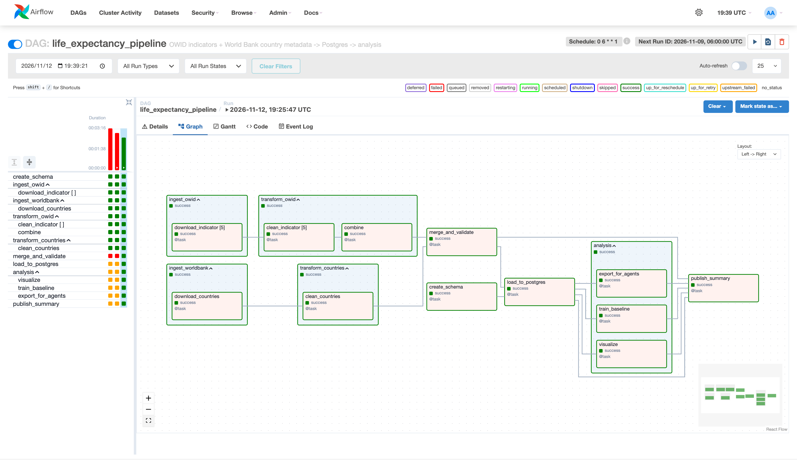
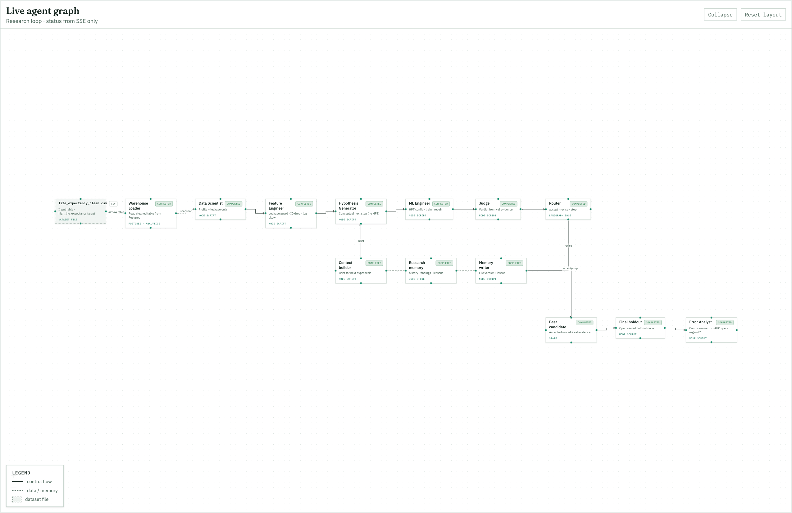
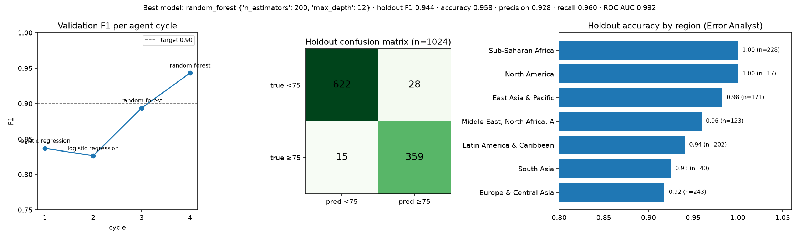

# IDS 706 Week 11 — Orchestration: Life-Expectancy Pipeline + Agent ML Loop

**Problem statement.** Which socioeconomic conditions — income, electricity access, urbanisation,
fertility, region and income group — separate country-years where people can expect to live
**75+ years** from those where they cannot?

* **Part 1** — an Airflow DAG ingests two related sources, cleans them, merges them, loads the result
  into PostgreSQL, then reads it back to visualise it and train a baseline model.
* **Part 2** — the in-class LangGraph agent loop
  ([Kedar-V/automl-research-lab](https://github.com/Kedar-V/automl-research-lab), branch
  `refactor/lab-solution-layout`) is adapted to train and evaluate a model on the Part 1 table, with
  three new agents and an updated live agent graph.

Everything runs in Docker (`infra/docker-compose.yml`, `infra/Dockerfile.airflow`,
`infra/Dockerfile.service`).

---

## Results at a glance

| | Model | Split | Accuracy | F1 | ROC AUC |
|---|---|---|---|---|---|
| Airflow `train_baseline` | Logistic regression (log GDP, scaled numerics, one-hot region/income) | By **country** (25% of countries unseen) | 0.890 | 0.841 | 0.955 |
| Agent loop — best of 4 cycles | Random forest (`n_estimators=200, max_depth=12`) | Random rows (template's sealed 20% holdout) | 0.958 | 0.944 | 0.992 |

* The agent loop tried logistic regression twice (val F1 0.837 → 0.826), switched to a random forest
  (0.894), then tuned it (0.943 ≥ 0.90 target → **Judge: accept**).
* **Read the two rows differently.** The agent loop uses the template's random row split, so other
  years of the same country can appear in both train and holdout. That makes its score optimistic.
  The Airflow baseline's country-grouped split is the better estimate for a country the model has
  never seen.
* Error Analyst (holdout): 28 false positives vs 15 false negatives. The weakest regions are
  Europe & Central Asia (0.92 accuracy), South Asia (0.93) and Latin America & Caribbean (0.94).
  These are the regions where many countries sit close to the 75-year line. Sub-Saharan Africa is
  "easy" (almost no country-year reaches 75).
* Income matters, but it is not the whole story. The scatter shows high-income outliers below the
  threshold (GDP > $40k but under 75 years: Brunei for the whole period, Saudi Arabia, Bahrain and
  Oman in the early 2000s) and middle-income countries above it. That is why a
  non-linear model beats a linear one.




---

## Part 1 — Airflow pipeline (`pipeline/`)

### Data sources (two related datasets)

| Source | Table(s) | Key | Fields used |
|---|---|---|---|
| [Our World in Data](https://ourworldindata.org) grapher CSVs (originally UN WPP & World Bank WDI) | 5 indicator tables: `life-expectancy`, `gdp-per-capita-worldbank`, `share-of-the-population-with-access-to-electricity`, `share-of-population-urban`, `children-per-woman-un` | `(ISO3, year)` | life expectancy, GDP per capita (PPP), electricity access %, urban population %, fertility rate |
| [World Bank country API](https://api.worldbank.org/v2/country?format=json&per_page=400) | country metadata (JSON) | `ISO3` | country name, region, income group, lending type |

Each run downloads the live data. If a source is down, the task falls back to the snapshot committed
in `pipeline/cache/`. The World Bank *indicator* API was timing out while this was built, which is why
the indicators come from OWID.

### DAG `life_expectancy_pipeline` (`pipeline/dags/life_expectancy_pipeline.py`)



| Stage | Task(s) | What happens |
|---|---|---|
| Setup | `create_schema` | `analytics.country_year_features` (PK `iso3, year`) + `analytics.pipeline_runs` audit table |
| Ingest | TaskGroup `ingest_owid` → `download_indicator` ×5 (dynamic task mapping) | one parallel task per OWID indicator, retries, cache fallback, schema check |
| Ingest | TaskGroup `ingest_worldbank` → `download_countries` | JSON → flat CSV |
| Transform | TaskGroup `transform_owid` → `clean_indicator` ×5 → `combine` | keep real ISO3 countries (drop `OWID_*` aggregates), years 2000–2023, numeric coercion, range checks, de-dup on `(iso3, year)`, then outer-join the 5 indicators |
| Transform | TaskGroup `transform_countries` → `clean_countries` | drop World Bank aggregates (`region.id == "NA"`), trim text, null "Not classified" income groups |
| Merge | `merge_and_validate` | inner join on `iso3` (`validate="many_to_one"`), keep rows with ≥3 of 4 features, build target `high_life_expectancy = life_expectancy ≥ 75`, **data-quality gate** (row count, unique keys, no null target, target rate in [0.1, 0.9]) that fails the run instead of loading bad data |
| Load | `load_to_postgres` | idempotent `TRUNCATE` + bulk insert in one transaction, **row-count reconciliation** (rows sent = rows in table), audit row in `pipeline_runs` |
| Analyze | TaskGroup `analysis` → `visualize`, `train_baseline`, `export_for_agents` (parallel) | all three **read from Postgres**: two charts, a country-grouped logistic regression (`reports/pipeline/baseline_metrics.json`), and a CSV export for the agent UI |
| Report | `publish_summary` | `reports/pipeline/last_run_summary.json` |

Latest run: **5,118 rows**, **214 countries**, target rate 0.365, 0 duplicate keys.

### Scheduling and parallelism

* `schedule="0 6 * * 1"` (Mondays 06:00 UTC). OWID and World Bank update at most weekly.
  `catchup=False`, `max_active_runs=1`, `retries=2` with a 30 s delay.
* The two sources are ingested **in parallel**. Inside `ingest_owid` and `transform_owid`, dynamic
  task mapping (`.expand()`) fans out one task instance per indicator (`[5]` in the graph), so the five
  downloads and five cleans each run concurrently under the `LocalExecutor` (parallelism 8). After
  loading, the three analysis tasks also run in parallel.
* The warehouse connection is defined as code (`AIRFLOW_CONN_WAREHOUSE_DB`), so no manual
  *Admin → Connections* step is needed.

Screenshots: [DAG list](docs/screenshots/01_airflow_dag_list.png) ·
[successful run (grid)](docs/screenshots/02_airflow_grid_success.png) ·
[graph view](docs/screenshots/03_airflow_graph_view.png) ·
[graph, groups expanded](docs/screenshots/04_airflow_graph_expanded.png).
The two red runs in the grid are the first attempts. They failed on a missing output directory, which
is fixed in `pipeline/etl.py`. The green run is after the fix.

---

## Part 2 — Agent-based ML workflow (`solution/langgraph/graph.py`)



```
START → warehouse_loader → data_scientist → feature_engineer → hypothesis_generator → ml_engineer → judge → router
                                                                 ↑                                         │ revise
                                                                 └── context_builder ← research_memory ← memory_writer
                                                                                                           │ accept/stop
                                             best_candidate → holdout_eval → error_analyst → END
```

### Agent modifications vs. the in-class template

| Change | Where | Why |
|---|---|---|
| **New: Warehouse Loader** | `node_warehouse_loader` | Reads `analytics.country_year_features` straight from Postgres (`WAREHOUSE_URL`), so the agents train on the cleaned data from Part 1, not a hand-copied CSV. Falls back to the CSV for other datasets. |
| **New: Feature Engineer** | `node_feature_engineer` | Generic leakage guard: any numeric column that a depth-1 tree can use alone to predict the target with ≥98% accuracy is dropped. This automatically catches `life_expectancy`, from which the target is derived. It also drops high-cardinality IDs (`country`, `iso3`) and log-transforms heavily skewed positive features. The template's Data Scientist heuristic only knew Titanic-style ID names and would have leaked the answer. |
| **New: Error Analyst** | `node_error_analyst` | After the sealed holdout: confusion matrix, precision/recall, ROC AUC and per-region accuracy/F1 for the best spec. |
| **Modified: Hypothesis / ML Engineer heuristics** | `loop_runtime.py` `_heuristic_plan`, `_heuristic_spec` | The template kept adding capacity to logistic regression forever when it was below target. Now: after 2 under-target tries of the same family, switch family; when tuning capacity, tune the family that was just tried. |
| **Updated live agent graph** | `frontend/src/graph/simpleLoopConfig.ts` | 3 new nodes, new edges (`airflow table → Warehouse Loader → snapshot → Data Scientist → Feature Engineer → …`, `Final holdout → Error Analyst`), re-laid-out grid, SSE node mapping |
| Gateway / infra | `advanced/services/gateway/app/main.py`, `infra/docker-compose.yml` | node list, `psycopg2-binary`, `WAREHOUSE_URL`, slim stack (no MLflow/orchestrator/harness) that fits in ~4 GB of Docker RAM; configurable `GATEWAY_PORT` |

The LLM agents (Data Scientist, Hypothesis, ML Engineer, Judge) use OpenRouter when
`OPENROUTER_API_KEY` is set in `.env`. The submitted runs use the template's heuristic fallbacks
(no key), so they are deterministic and reproducible.

Evaluation: [dashboard](docs/screenshots/05_agent_loop_dashboard.png) ·
[evaluation figure](docs/screenshots/07_agent_evaluation.png) ·
full JSON in `reports/agent_loop_result.json`.



---

## How to run

Prereqs: Docker Desktop (≥4 GB RAM), Node 20+, Make.

```bash
cp .env.example .env          # set GATEWAY_PORT if 8000 is taken; optional OPENROUTER_API_KEY
make up                       # warehouse Postgres + Airflow + agent gateway
```

**Part 1 — Airflow**

1. Open http://localhost:8088 (admin / admin), unpause `life_expectancy_pipeline` and click ▶ Trigger
   (or run `make trigger`).
2. Watch the Grid / Graph tabs. Outputs: table `analytics.country_year_features`
   (`psql -h localhost -p 5433 -U warehouse warehouse`), `reports/pipeline/*`,
   `datasets/life_expectancy_clean.csv`.

**Part 2 — Agent loop**

```bash
make frontend                 # Vite UI on http://127.0.0.1:5173
# if GATEWAY_PORT != 8000:  GATEWAY_URL=http://127.0.0.1:<port> npm --prefix frontend run dev
```

Open http://127.0.0.1:5173/solution-loop, choose `life_expectancy_clean.csv`, target
`high_life_expectancy`, target score 0.9, budget 4, then **Run loop**. Headless alternative:
`make loop-cli` (writes `reports/agent_loop_result.json` and the evaluation figure).

**Tests**: `make test` runs the 5 unit tests for the ETL steps, the quality gate and the leakage guard
inside the Airflow image. **Stop**: `make down`.

### Dev container

`.devcontainer/devcontainer.json` reuses `infra/docker-compose.yml` and attaches VS Code to the
Airflow scheduler container (`/repo`), with ports 8088 / 8000 / 5173 forwarded.

---

## Repository layout

```
pipeline/                 Part 1
  dags/life_expectancy_pipeline.py   Airflow DAG (TaskGroups, dynamic mapping, schedule)
  etl.py                             pure ingest/clean/merge/quality functions (unit-tested)
  cache/                             source snapshots used as offline fallback
solution/langgraph/graph.py          Part 2 — modified LangGraph agent loop
loop_runtime.py                      shared LLM/heuristic/training helpers (heuristics modified)
frontend/src/graph/simpleLoopConfig.ts  live agent graph definition (updated)
infra/                               docker-compose (slim) + Dockerfiles; template's full stack kept as docker-compose.template-full.yml
reports/                             pipeline + agent outputs
docs/screenshots/                    submission screenshots
tests/unit/test_pipeline_etl.py      ETL + agent tests
```

Template credit: AutoML Research Lab by the IDS 706 TA team (original README in
`docs/TEMPLATE_README.md`). Data: Our World in Data (CC BY 4.0) and World Bank (CC BY 4.0).
